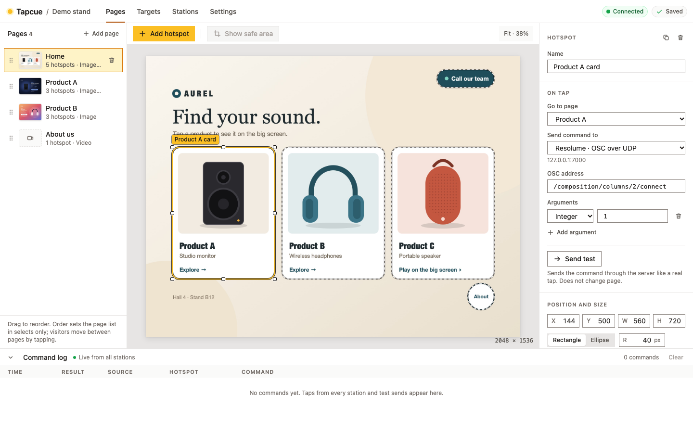
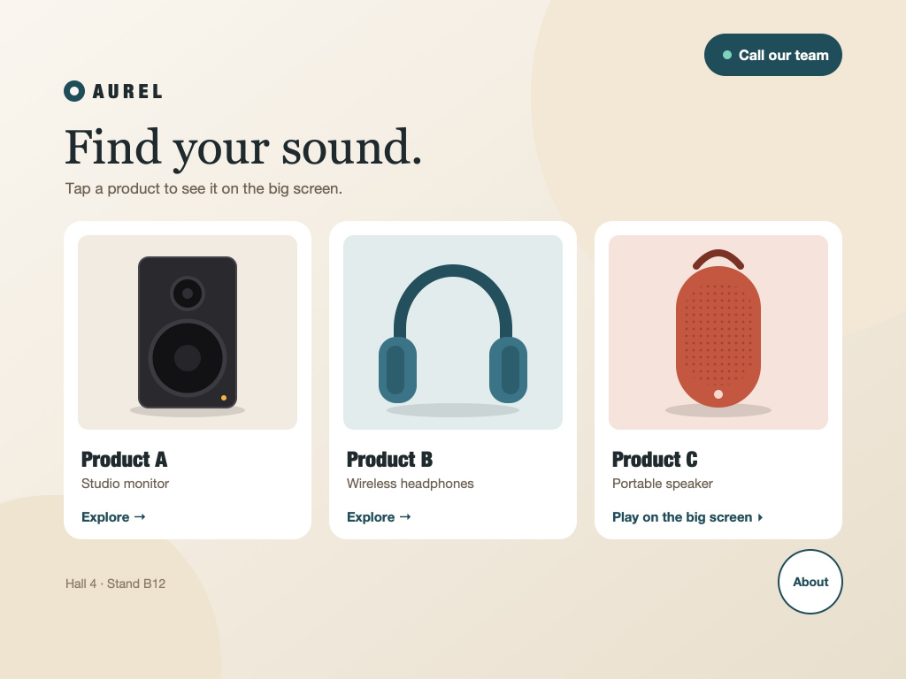
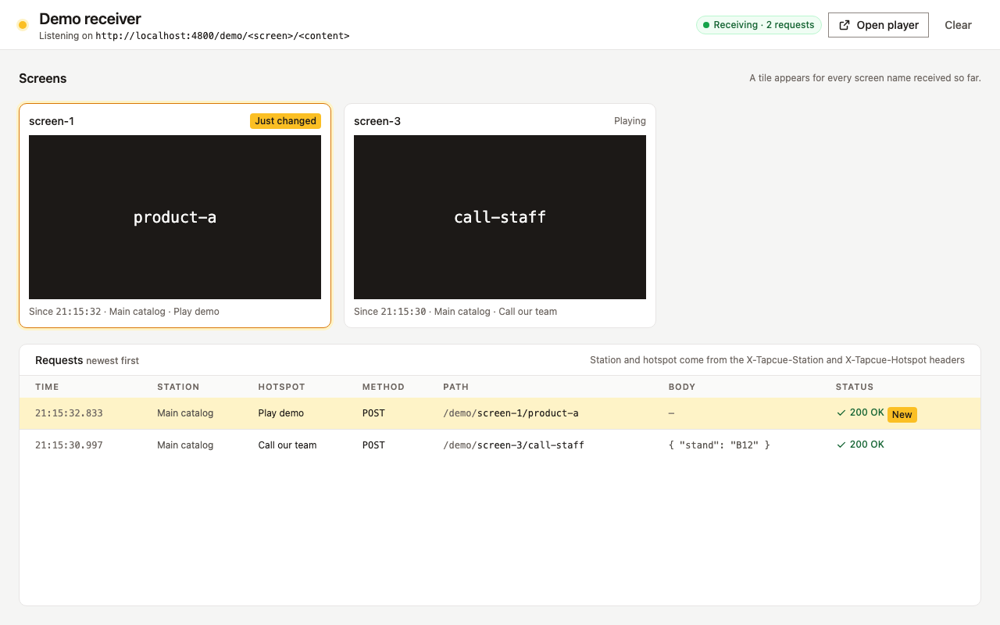
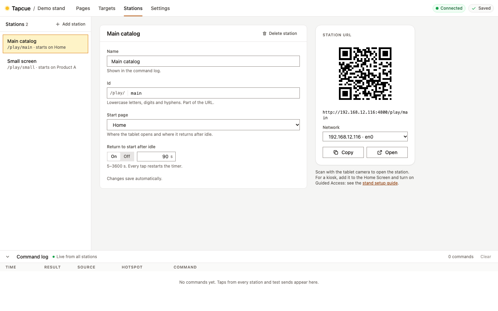

<p align="center">
  <picture>
    <source media="(prefers-color-scheme: dark)" srcset="docs/design/brand/tapcue-logo-dark.svg">
    
  </picture>
</p>

# Tapcue

[](https://github.com/onovokhatski/tapcue/actions/workflows/ci.yml)

**Beautiful touch interfaces for exhibition stands, wired to your media server.**

> **Status:** v0.1 is in its last milestone (M5, reliability and showcase). Everything described
> below works today; see the [roadmap](docs/roadmap.md) for what is left before the release.



| The player on a tablet | The built-in demo receiver |
|---|---|
|  |  |

[Watch a 15-second tour of the player](docs/media/player-tour.webm) (WebM video).

Each tablet opens its station by scanning a QR code in the editor:



## What it is

An exhibition stand often has a large screen, a few smaller ones, and a tablet for visitors.
Tapping something on the tablet should bring up related content on the screens, which are
driven by a media server such as QLab or Resolume.

Tapcue lets an integrator turn designer-made artwork into that tablet interface in an evening:

1. Upload the designer's images or video loops as pages.
2. Place hotspots over the drawn buttons — invisible, or styled with a press effect.
3. Make each hotspot open another page, send a command to the media server, or both.
4. Scan a QR code with the tablet. Done.

All show logic stays on the media server; Tapcue only provides the interface and delivers
the commands.

## How it works

```
 Tablet (browser)          Tapcue server (local network)          Media server
 ┌──────────────┐  tap    ┌─────────────────────────────┐  OSC   ┌────────────┐
 │    Player    │────────▶│ finds the hotspot's action, │───────▶│ QLab,      │
 └──────────────┘         │ sends its command           │  UDP   │ Resolume,  │
 ┌──────────────┐  edit   │                             │  HTTP  │ ...        │
 │    Editor    │────────▶│ stores the project, pushes  │        └────────────┘
 └──────────────┘         │ updates to all tablets      │
                          └─────────────────────────────┘
```

- Runs entirely in the stand's local network — no internet, no accounts, no installation on tablets.
- One server, any number of tablets, each with its own interface if needed.
- Commands: OSC over UDP, raw UDP, HTTP.

## What it does

- **Pages** with image or looping video backgrounds, `fit` or `fill` scaling, and a safe-area
  overlay that shows what a 16:10 or 16:9 screen crops.
- **Hotspots:** rectangles and ellipses, invisible or styled, with press effects; each one opens
  a page, sends a command, or both. "Send test" fires a command from the editor.
- **Targets:** where commands go — OSC over UDP, UDP or HTTP — with a log of every command sent.
- **Stations:** an entry point per tablet with its own start page and idle return, opened by
  scanning its QR code.
- **Live editing:** every open tablet follows each change within a second, without reloading.
- **Reliable on the stand:** tablets keep working through Wi-Fi drops and reconnect on their own.
- **Export and import** the whole project, backgrounds included, as one `.zip` file.
- **Demo receiver and demo project:** try the whole flow without any hardware.
- **Demo mode** for a public online demo: nothing is saved, and commands never leave the server.

The full list is in the [specification](docs/spec.md).

## Getting started

Requirements: [Node.js](https://nodejs.org/) 22 or newer, and Git.

```bash
git clone https://github.com/onovokhatski/tapcue.git
```

```bash
cd tapcue
```

```bash
npm install
```

```bash
npm start
```

`npm start` builds the web app, starts Tapcue on port 4000 with the demo stand, and prints the
addresses to open:

```
Tapcue is running with "Demo stand".
  Editor:  http://192.168.1.40:4000/edit
  Tablets: Main catalog  http://192.168.1.40:4000/play/main
           Small screen  http://192.168.1.40:4000/play/small
```

Open the editor on this computer, a station on a tablet (or in another browser tab), and the
demo receiver at `/demo`: taps on "Call our team" or "Play demo" appear there. To work on your
own stand, start Tapcue with a project folder of its own:

```bash
npm start -- --project ./my-stand
```

Before the stand opens, follow the [stand setup guide](docs/stand-setup.md): network, the Tapcue
computer and each tablet.

### The click-to-run app

Tapcue also comes as an app that needs no Node.js and no terminal
([ADR 0017](docs/adr/0017-click-to-run-app.md)): `Tapcue.app` for macOS and `Tapcue.exe` for
Windows, built by CI and attached to each release from v0.1. A click starts Tapcue and opens the
editor in the browser; your project lives in `Documents/Tapcue`, which starts as a copy of the
demo stand. Clicking it again while it runs just opens the editor.

The apps are not code-signed yet, so the first start needs one extra step:

- **macOS:** right-click `Tapcue.app` → Open → Open. Tapcue runs in the background, without a
  Dock icon.
- **Windows:** unzip the folder, start `Tapcue.exe`, and on the SmartScreen notice choose More
  info → Run anyway. A console window shows that Tapcue runs.

To stop the app, choose **Quit Tapcue** in the editor's Settings tab. Closing the console window
on Windows, or quitting "Tapcue" in Activity Monitor on macOS, works too.

## Security

Tapcue is designed for a **trusted local network**, such as a stand's own access point. In
v0.1 the editor has no password: anyone on the network can change the project. Do not
expose a Tapcue server to the internet except in demo mode. The
[stand setup guide](docs/stand-setup.md) shows how to keep the network and the tablets locked down.

## Documentation

| Document | Content |
|---|---|
| [Specification](docs/spec.md) | What Tapcue does: requirements, screens, user flows |
| [Architecture](docs/architecture.md) | How it is built: packages, modules, protocols, reliability |
| [Stand setup](docs/stand-setup.md) | Network, the Tapcue computer and each tablet, before the stand opens |
| [Project format](docs/project-format.md) | The `project.json` reference |
| [Roadmap](docs/roadmap.md) | Phases, milestones and how work is done |
| [Decisions](docs/adr/README.md) | Architecture decision records |
| [Design](docs/design/README.md) | Design system, components and a prototype of every screen |

## Tech stack

TypeScript · React · Vite · Zustand · Tailwind CSS · Node.js · Fastify · WebSocket · Zod ·
Vitest · Playwright · GitHub Actions

## Development

```bash
npm install
```

| Command | What it does |
|---|---|
| `npm start` | Runs Tapcue as on a stand: builds the web app, serves everything on port 4000 and prints the editor and station URLs (`--port`, `--project <folder>`) |
| `npm run dev` | Starts the server (port 4000) and the web app (http://localhost:5173) with live reload |
| `npm run build` | Builds the web app for production |
| `npm run typecheck` | Type-checks every package (TypeScript, strict mode) |
| `npm run lint` | Lints the code (ESLint with type-aware rules) |
| `npm run format` | Formats the code (Prettier); `format:check` only reports |
| `npm test` | Runs the tests of every package once (Vitest); `test:watch` re-runs on change |
| `npm run test:e2e` | Runs the end-to-end tests in Chromium, WebKit and Firefox (Playwright): editor, player and demo receiver together. First time: `npx playwright install chromium webkit firefox` |
| `npm run soak -- --minutes 600` | A long run of a stand without anyone touching it: taps for the given time, then a report of deliveries, errors and memory. Build first (`npm run build`) |
| `npm run media` | Makes this README's screenshots and player tour again (`docs/media/`). Build first |
| `npm run package:app -w @tapcue/server` | Builds the click-to-run app for this system: `Tapcue.app` on macOS, `Tapcue.exe` on Windows, and a `.zip` of it, in `packages/server/dist/app/` |

`.nvmrc` pins the Node.js version used in CI. CI runs type check, lint, format check, tests and
end-to-end tests on every pull request, starts Tapcue on Windows and macOS, and builds and starts
the click-to-run app on both; `main` only
changes through pull requests with a green CI.

The repository is an npm workspace with three packages:

| Package | Responsibility |
|---|---|
| `packages/shared` | Project format and message schemas, shared types |
| `packages/server` | Project storage, HTTP API, WebSocket, command drivers |
| `packages/web` | Editor, player and demo receiver |

`server` and `web` depend only on `shared`, never on each other
([ADR 0002](docs/adr/0002-npm-workspaces.md)).

## License

[MIT](LICENSE) © Oleg Novokhatskyi
